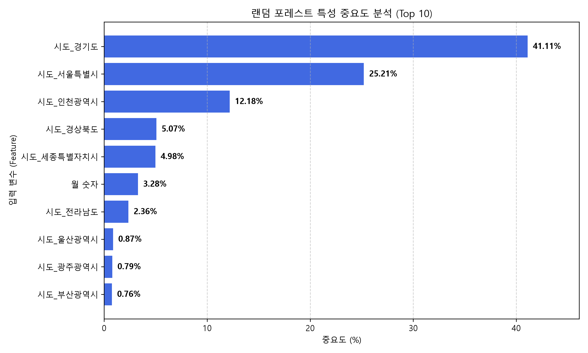
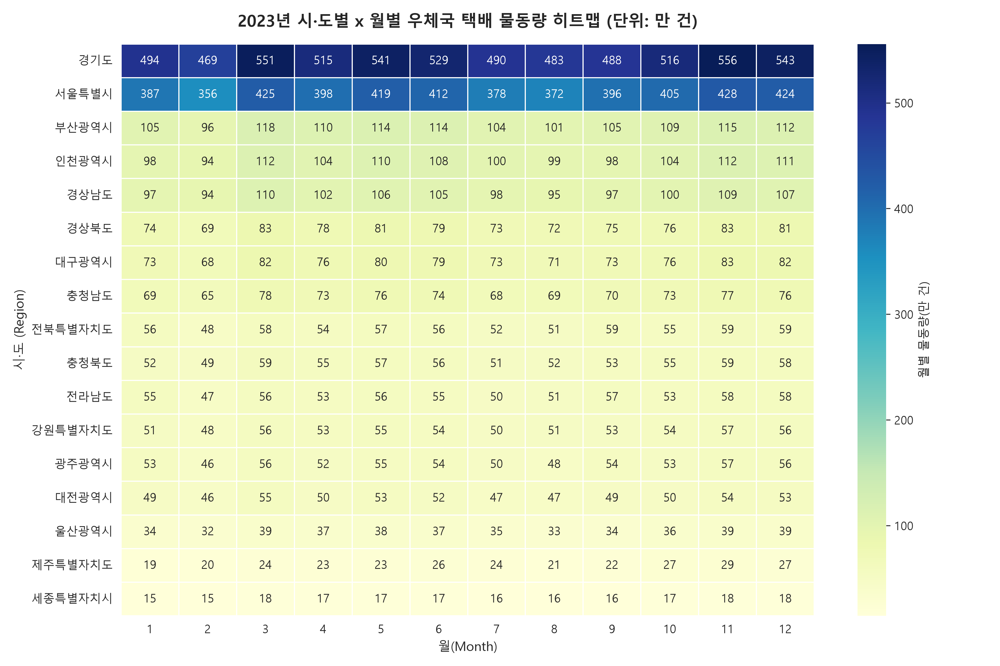

# 2023 우체국 택배 물동량 데이터 분석 및 수요 예측 모델링

공공데이터포털의 2023년 전국 우체국 택배 배달 물동량 데이터를 활용하여, 광역지자체별 공간적 집중도와 월별 계절성 특성을 분석하고 머신러닝 회귀 모델 기반의 택배 수요 예측을 수행한 프로젝트입니다.

---

## 프로젝트 개요
- **주제:** 2023 우체국 택배 배달지 기준 물동량 데이터를 활용한 지역별/계절별 수요 패턴 분석 및 예측
- **분석 대상:** 전국 34,502개 국가기초구역(5자리 우편번호) 전수 데이터 (총 414,024행)
- **개발 환경:** VS Code (Jupyter Notebook)
- **사용 언어 및 라이브러리:** Python 3.12.10, Pandas, NumPy, Scikit-learn, Matplotlib, Seaborn

---

## 데이터 전처리 및 피처 엔지니어링 (Preprocessing) (9주차)
1. **우편번호 정제:** 5자리 문자열 규격화 (`zfill(5)`)
2. **구조 재배치 (Melt):** 가로형(Wide) 월별 데이터를 세로형(Long) 시계열 구조로 재구성
3. **파생변수 생성:**
   - 우편번호 앞 2자리 기준 전국 17개 `시/도` 권역 자동 매핑
   - 주요 특수기(1, 2, 9, 10, 12월) 구분을 위한 `피크시즌` 레이블링 (Binary)
4. **원-핫 인코딩:** 범주형 변수(`시/도`)의 머신러닝 입력용 One-Hot Encoding 적용

---

## 머신러닝 모델링 및 평가 (10주차)
데이터를 8:2 비율(Train: 331,219개 / Test: 82,805개)로 분할하여 **선형 회귀(Linear Regression)** 및 **랜덤 포레스트 회귀(Random Forest Regressor)** 모델을 구현하고 성능을 평가하였습니다.

### 모델 성능 비교
| 모델 (Model) | R² Score (결정계수) | RMSE (평균 제곱근 오차) | MAE (평균 절대 오차) |
| :--- | :---: | :---: | :---: |
| **선형 회귀 (Linear Regression)** | `0.0639` | `809.02건` | `435.83건` |
| **랜덤 포레스트 (Random Forest)** | **`0.0641`** | **`808.91건`** | **`435.70건`** |

### 모델 해석 및 한계점
- **낮은 예측 정확도($R^2 \approx 0.064$)의 원인:** '어느 시·도인지'와 '몇 월인지'라는 큰 단위의 정보만으로는 전국 34,502개 세부 우편번호 구역마다 다르게 발생하는 택배 물량 차이를 모두 맞히는 데 한계가 있었습니다.
- **물량이 많은 지역을 낮게 예측하는 현상:** 대단지 아파트나 대형 쇼핑몰처럼 택배가 유독 많이 몰리는 우편번호 구역도 모델이 해당 시·도의 평균 물량 수준으로만 낮춰서 예측하는 경향을 보였습니다. 향후에는 우편번호별 **거주 인구수, 세대수, 상권 정보** 같은 세부 데이터를 함께 학습시키면 예측 정확도를 크게 높일 수 있습니다.

---

## 특성 중요도 분석 및 시각화 (11주차)
랜덤 포레스트 모델의 입력 변수별 기여도(Feature Importance)를 산출하고 Matplotlib 수평 막대그래프(`barh`)로 시각화하여 물동량 예측의 핵심 결정 요인을 도출하였습니다[cite: 20].



###  주요 변수 순위 (Top 6)
| 순위 | 입력 변수 (Feature) | 중요도 (%) | 구분 |
| :---: | :--- | :---: | :---: |
| **1** | **시도_경기도** | **41.11%** | 수도권 |
| **2** | **시도_서울특별시** | **25.21%** | 수도권 |
| **3** | **시도_인천광역시** | **12.18%** | 수도권 |
| **4** | 시도_경상북도 | 5.07% | 비수도권 |
| **5** | 시도_세종특별자치시 | 4.98% | 비수도권 |
| **6** | **월 숫자** | **3.28%** | 계절성 |

- **수도권 집중 현상 입증:** 경기(41.11%), 서울(25.21%), 인천(12.18%) 등 수도권 3개 권역이 전체 예측 기여도의 약 78.5%를 차지하였습니다.
- **공간 요인 우세:** 시간·계절성 변수(`월 숫자`, 3.28%)보다 지역(`시/도`) 변수가 택배 물동량 규모를 결정짓는 지배적 요인임을 확인하였습니다.

---

## 시·도별 × 월별 교차 패턴 심화 시각화 (12주차)
Seaborn의 `heatmap()`을 활용하여 전국 17개 시·도와 1~12월 간의 월별 총 물동량(단위: 만 건) 교차 분포를 시각화하고 전체 데이터 기술통계량을 산출하였습니다[cite: 80].



### 주요 인사이트
- **수도권의 연중 압도적 비중:** 경기도(월 평균 약 510만 건)와 서울특별시(월 평균 약 400만 건)가 1년 내내 타 광역지자체 대비 압도적인 물동량 규모를 유지하였습니다[cite: 80].
- **계절적 피크 교차 확인:** 전 지역 공통으로 2월(비수기)에 일시 감소한 뒤, 3월(신학기·봄철 수요)과 11월(블랙프라이데이·연말 쇼핑 시즌)에 연간 최고치(경기도 556만 건, 서울 428만 건)를 기록하는 뚜렷한 계절적 교차 패턴이 확인되었습니다[cite: 80].

---

## 프로젝트 폴더 구조
```text
.
├── 10week_ml.ipynb              # 10주차 머신러닝 모델링 및 평가 코드
├── 11week_viz.ipynb             # 11주차 특성 중요도 분석 및 시각화 코드
├── 12week_viz.ipynb             # 12주차 기술통계량 산출 및 시·도×월별 히트맵 시각화 코드
├── Preprocessing.ipynb          # 데이터 정제, Melt 및 파생변수 생성
├── Visualization.ipynb          # 탐색적 데이터 분석(EDA) 차트 생성
├── feature_importance.png       # 11주차 특성 중요도 시각화 이미지
├── sido_month_heatmap.png       # 12주차 시·도×월별 물동량 히트맵 이미지[cite: 80]
├── summary_by_zipcode.csv       # 우편번호별 요약 통계
├── 기말 프로젝트 주차별 정리.txt # 주차별 과제 진행 기록
└── README.md                    # 프로젝트 종합 설명서